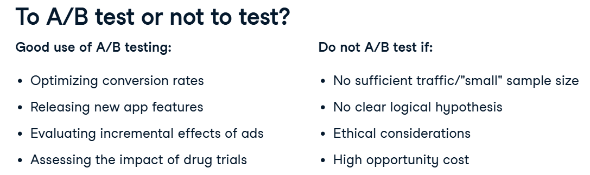
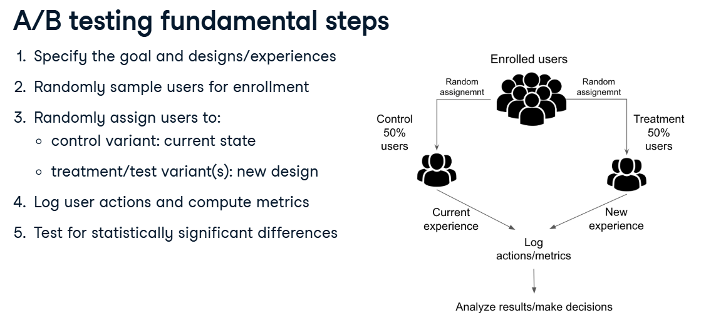
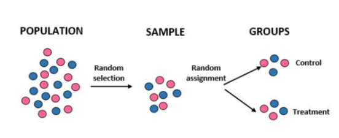
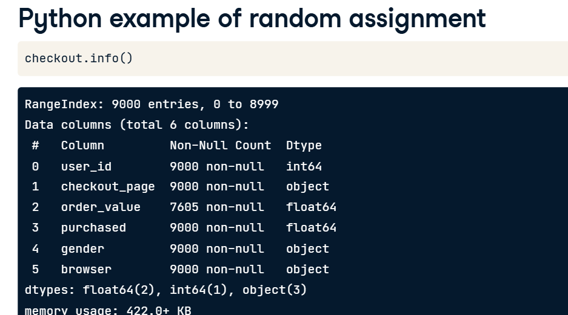
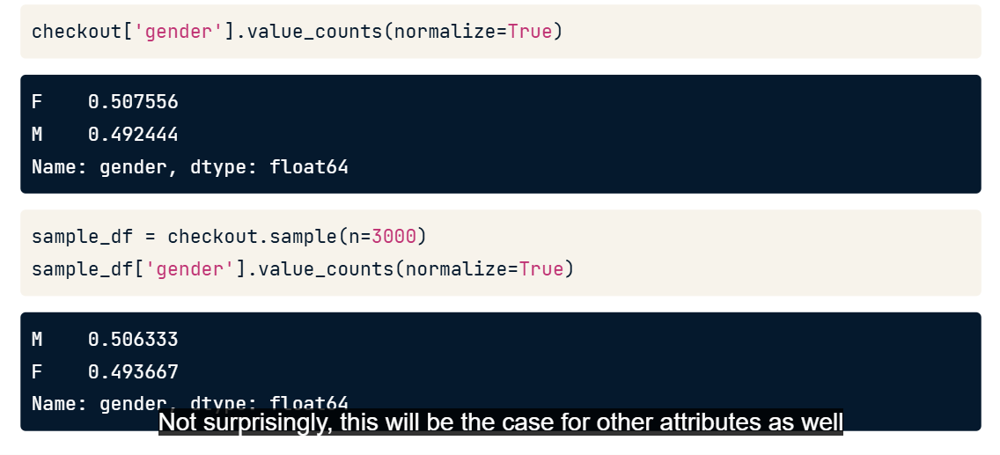
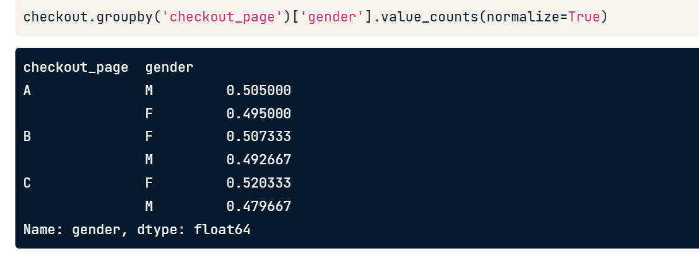
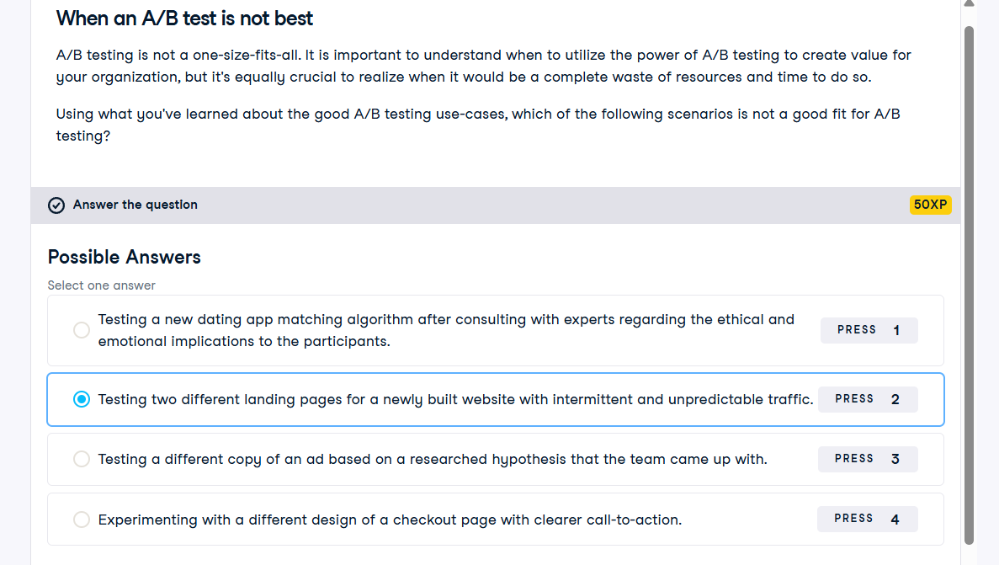
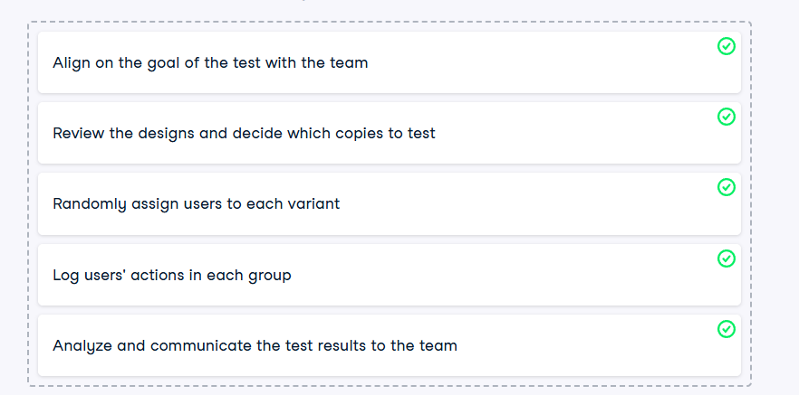
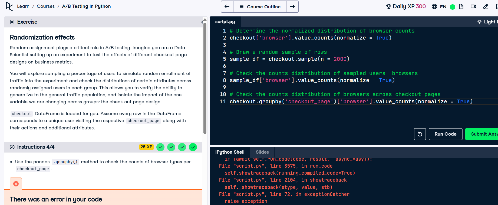

# What is A/B Testing?

An experiment designed to test which version is better (mostly online experiences).
Based on metrics: signup rate, average sales per user, etc.
It is done by using random assignment and analyzing results. 

## To A/B test or not to test? 
It might not always be recommended to A/B test. 

## Steps

## critical to the success of A/B tests is the value of randomization
generalizability and representativeness 

minimizing bias between groups
establishing causality by isolating treatment effect(isolate the effects of our changes)

Random selection vs Random assignment:

## Python example of random assignment- checkout dataset
experiment ran on different checkout page designs to evaluate their impact on users' purchases. 

Gender split:

## Exercise 1
New websites usually have limited traffic which reduces our chances of reaching conclusive results.

Testing two different landing pages for a newly built website with intermittent and unpredictable traffic. A/B test not the best.

## Logical flow of A/B process

## exercise 2

## WHY RUN EXPERIMENTS?
